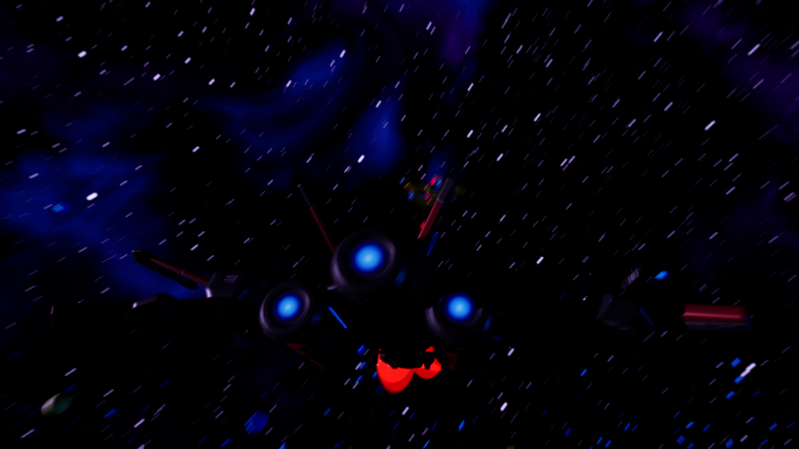
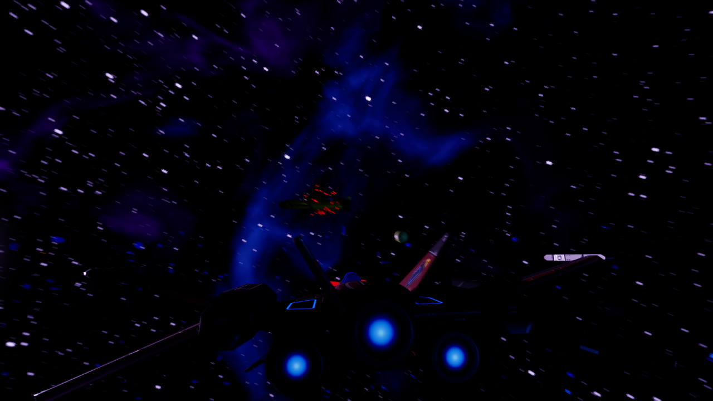
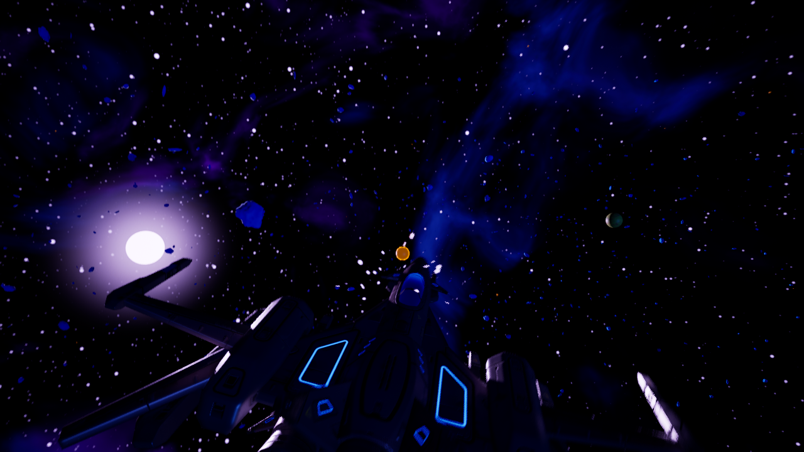

# Death sequence: Phase 1 report

Every ship death now has a 1 s dying state between hull 0 and removal. Enemies and the player share it.

1. **At hull 0:** the kill is credited and the drop is rolled. The ship stops, becomes untargetable and stops blocking anything.
2. **For 1 s:** the wreck drifts and tumbles, its hull flashes towards white, and 2–3 secondary explosions go off.
3. **At the end:** the final explosion, then the ship hides and the loot (or the player's cargo) drops where the wreck exploded. Then the enemy returns to the pool, or the player's respawn flow starts.

All 16 `Startech` automation tests pass, 3 of them new. The build has no new warnings. No plugin changed.

Phase 0 answers applied:
- Pause stays refused while dead, including the dying second.
- The cockpit view switches to the chase camera until the respawn.
- The duration and default effects live in the project settings.
- `NS_Laser_Hit` is the placeholder for both explosions, at ×1 for the secondaries and ×3 for the final one.

## What was built

### One component: `UShipDeathComponent`
It is the subobject `ShipDeath` on `AStartechShipBase`, so every ship type gets it. Source: `Source/Startech/Public|Private/Death/`.

| Step | Where | What |
|---|---|---|
| Hull 0 | `AStartechShipBase::HandleHealthDeath` (`StartechShipBase.cpp:54`) | Runs the virtual `HandleDeath` first (everything that counts), then `ShipDeath->BeginDying(GetDeathEffects())`. |
| Dying | `UShipDeathComponent::TickComponent` (`ShipDeathComponent.cpp:92`) | Tumble, flash, secondary explosions. Driven by the component's own tick, not timers, so it pauses with the game. |
| Drift | `AStartechShipBase::Tick` (`StartechShipBase.cpp:83`) | While the ship isn't alive, the flight model's turning and braking are skipped and only `MoveShip` runs, so the wreck keeps its velocity. After the explosion it doesn't move. |
| End | `UShipDeathComponent::Explode` (`:366`) | Spawns the final effect and plays the sound at the wreck, hides the actor, then fires `OnExploded(Location)`, which calls the virtual `HandleDyingFinished(Location)`. |
| Reset | `UShipDeathComponent::ResetDeath` (`:138`) | Puts back collision responses, overlap events, the mesh's override materials and the tick. Runs from the component's own pool hooks, `AStartechEnemyShip::ResetForNewLife` and `AStartechShipPawn::RespawnAt`. |

### Wreck collision (`MakeWreckCollision`, `:168`)
- Every colliding primitive ignores `ECC_Visibility` (shots) and `ECC_Pawn` (ships), and generates no overlaps. A drifting wreck therefore can't dock, enter a gate or collect a pickup.
- The world still blocks it, so it doesn't drift through asteroids.
- The previous responses are saved per primitive and restored as they were.

### Flash (`StartFlash` / `ApplyFlash`, `:221`, `:269`)
- **Yes, the ship materials have usable parameters.** All four ships use StarSparrow's `M_Colorize`.
- At the death, one dynamic material is made per slot:
  - `Color 1–3` blend towards white, up to `FlashMaxWhite` (0.85).
  - `EmissionMultiplier` is multiplied by up to 1 + `FlashEmissionBoost` (6).
- The flash builds up over the second (progress²), flickers at 12 Hz and pulses at each secondary explosion.
- Parameters a material doesn't have are skipped. The StarSparrow assets are unchanged, and the original overrides are put back on reset.

### Secondary explosions (`ScheduleSecondaries`, `:331`)
- 2–3 per death, one in each equal part of the window from 15% to 85% of the state.
- Each goes off at a random point inside 70% of the mesh's bounds.

### Enemy (`StartechEnemyShip.cpp`)
- `HandleDeath` (`:233`) at hull 0:
  - stops the AI, intents and weapons; the velocity stays
  - rolls the drop (`RollLoot`, `:190`, into `LastDrop`)
  - fires `OnEnemyDied` and `OnAnyEnemyDied` (combat log)
  - reports the quest kill
- `HandleDyingFinished` (`:261`): `SpawnLoot` at the explosion's location (`:213`, once per life), then `UDespawnSubsystem::Despawn`.
- `DestroyDelay` (1.5 s) and its timer are removed; `DeathDuration` replaces them.

### Player (`StartechShipPawn.cpp`)
- `HandleDeath` (`:209`) at hull 0:
  - closes the hub, clears the intents and the facing point, stops boost and weapons
  - releases the lock and stops targeting
  - leaves the cockpit view (`bCockpitBeforeDeath`) and disables input
  - **Changed:** the velocity is no longer zeroed, so the wreck drifts.
- `HandleDyingFinished` (`:241`) runs the existing flow:
  - hide, collision off, drop cargo at the explosion's location (clamped into the play area as before)
  - reset the sector timer, `OnPlayerDied`
  - `UHomeRespawnSubsystem::BeginDeathSequence` (fade out, HUD fold) and the 2 s respawn timer
- The chase camera keeps the heading it had at the death (`UpdateLook`, `:993`). It follows the ship's yaw, which a tumbling wreck swings about.
- `RespawnAt` (`:350`) resets the death component before collision comes back on, and turns the cockpit view back on if it was on (`:374`).

### Data
- **Effects:** `FShipDeathEffects` (`ShipDeathTypes.h`) holds the soft, optional effect fields:
  - `DeathExplosionFX`, `DeathExplosionScale`
  - `SecondaryExplosionFX`, `SecondaryExplosionScale`
  - `DeathSound`
- **Where each type sets them:**
  - Enemies: `UEnemyData::DeathEffects`.
  - Other ships, including the player's Blueprint: `AStartechShipBase::DeathEffects`.
  - Each empty field falls back to the default.
- **Settings:** `UStartechSettings::Death` (`FShipDeathSettings`) holds:
  - `DeathDuration` (1 s)
  - `DefaultEffects`
  - secondary count (2–3), `MaxTumbleRate` (120°/s; the tumble starts at a tenth)
  - flash strength, flicker and parameter names
- **`DefaultGame.ini`:** `DeathExplosionFX` and `SecondaryExplosionFX` are `/Game/VFX/NS_Laser_Hit`, with `DeathExplosionScale=3`. `DeathSound` is empty, because the project has no sounds yet.
- **Empty data is safe:** an empty effect field spawns nothing, and `DeathDuration=0` explodes in the same frame.

### Test aids (non-shipping, `Private/Death/DeathConsoleCommands.cpp`)
- `Startech.Test.Death` logs one `[Death]` line for the player, for nearby enemies and for every wreck. Each line shows:
  - state, elapsed time, tumble, flash and speed
  - visibility
  - shot and ship collision, overlaps, targetability
  It also prints the number of loot pickups in play.
- `Startech.Test.DeathShot [Seconds=0.5] [Count=3]` takes a screenshot that long after each of the next deaths, and logs that ship's line.
- The component logs `[Death] <ship> dying …` and `… exploded after N s at …`.

## Automation tests (`Private/Tests/StartechDeathTests.cpp`)

The tests use a real game world ticked by hand, with the real Blueprints (`BP_Enemy_Drifter` from the pool, `BP_ShipPawn`).

| Test | Checks |
|---|---|
| `Startech.Death.EnemyCreditedAtHullZeroLootAfterDelay` | At hull 0: `OnAnyEnemyDied` has fired, the drop is rolled, untargetable, a 50 cm Visibility sweep and a Pawn sweep pass through the wreck, no pickup. Halfway: still dying, visible, tumbling, still no pickup. After the delay: exploded, at least 2 secondary explosions, exactly one pickup at the explosion's location (±1 cm). |
| `Startech.Death.PooledEnemyComesBackClean` | Kill, then release the enemy to the pool halfway through the dying state (as a sector switch does), while it is tumbled and flashing. Re-acquired, it is the same actor with everything back: death component alive and not ticking, no tumble, health alive, targetable, drop cleared, collision responses and overlaps restored, original materials, visible, blocks shots. One more second later: no explosion and no loot from the released death. |
| `Startech.Death.PlayerFlowStartsAfterDelay` | At hull 0: dead and dying, the respawn sequence not started, the wreck visible, shots pass through. Halfway: still not started. After the delay: the respawn sequence has started and the ship is hidden. |

Three things the hand-ticked world needs, all handled in the fixture:
- `++GFrameCounter` per step, because tick functions run once per engine frame.
- No `World->BeginPlay`, because the start flow would generate a sector.
- `FAssetCompilingManager::FinishAllCompilation` after loading the Blueprints, or the first ship spawns before its collision exists.

## Play check in Terra

There were two windowed sessions on test slot 3 with no upgrades and LL1. The test pilot fought drifters, and `Startech.Test.DeathShot` took the screenshots. The logs are `Saved/Logs/DeathCheck.log` and `DeathCheck2.log`.

**Drifters (16 kills over both sessions).** Every one followed the same sequence:
```
[Pilot] killed Drifter (tier 1), 1 so far.
[Death] BP_Enemy_Drifter_C_0 dying for 1.00 s at V(X=-30397.98, Y=22115.50, Z=-4805.50)
[Death] BP_Enemy_Drifter_C_0: dying 0.52 s, tumble 69 deg/s, flash 0.27, speed 1800 cm/s, visible, shots ignore, ships ignore, overlaps off, untargetable
[Death] BP_Enemy_Drifter_C_0 exploded after 1.00 s at V(X=-32147.38, Y=22432.17, Z=-4805.50)
```
- The explosion came 1.00–1.01 s after hull 0 every time.
- A moving drifter kept its velocity: this one drifted about 18 m during the second.
- Mid-tumble, every wreck ignored shots and ships, had no overlaps and was untargetable.
- The pickup count rose after each explosion.
- The wreck was untargetable from hull 0, so the pilot's hard lock dropped and moved to the next drifter. Its next kill came about 4.5 s later, as before.
- Pooled drifters came back as live, normal enemies (`shots block, ships block, overlaps on, targetable`).

**The player died twice:**
- Once naturally in session 1: Terra with no upgrades, after 10 kills. This matches the "no hull repair in flight" follow-up.
- Once forced in session 2 with `Startech.HUD.Damage`:
```
[Death] BP_ShipPawn_C_0 dying for 1.00 s at V(X=7187.56, Y=63096.96, Z=1813.31)
[Death] BP_ShipPawn_C_0: dying 0.25 s, tumble 39 deg/s, flash 0.24, …, visible, shots ignore, ships ignore, overlaps off
[Death] BP_ShipPawn_C_0: dying 0.81 s, tumble 100 deg/s, flash 0.40, …
[Death] BP_ShipPawn_C_0 exploded after 1.01 s at V(X=7187.56, Y=63096.96, Z=1813.31)
LogStartechRespawn: Player died in 'Terra'; home is 'Terra'.      ← the existing flow starts only now
[Death] BP_ShipPawn_C_0: exploded …, hidden, …
OnDockedChanged: docked 'Station'                                    ← respawned 2.0 s after the explosion
[Death] BP_ShipPawn_C_0: alive 0.00 s, …, visible, shots block, ships block, overlaps on
```
`untargetable` on the player's lines only means the player has no targetable component.

**What it looks like:**
- The wreck visibly turns over in the second. The player's wreck was seen from below at a steep angle 0.6 s in, with the chase camera holding still on it.
- The hull's lit trim brightens and the panels go paler. It is subtle until the last third, where the flash is strongest.
- The secondaries (`NS_Laser_Hit`) show as small red bursts on the hull, and the final ×3 burst is clearly larger.
- At the pilot's distance the drifter wrecks are small on screen. Real explosion effects will carry most of the moment.

| | |
|---|---|
|  |  |
| Drifter wreck 0.5 s in (above the player's ship) | Drifter wreck 0.5 s in, secondary bursts on the hull |
|  | |
| The player's wreck 0.6 s in: tumbled, flashing, chase camera held | |

## Changes in behaviour and notes

1. **`DestroyDelay` is removed.** It was 1.5 s and no Blueprint overrode it. An enemy now leaves play 1.0 s after hull 0, so ProcSector's 30 s respawn starts 0.5 s sooner.
2. **`OnPlayerDied` now fires after the explosion**, with the rest of the existing flow. Nothing listens to it. Its comment says so.
3. **`HandleDeath` is no longer a `UFUNCTION`.** The health binding goes through the new `HandleHealthDeath`. No Blueprint used it, because it wasn't Blueprint-callable.
4. **A ship released during its dying state never explodes or drops loot.** The kill is still credited. In play this only happens when a sector switch starts within 1 s of a kill. A warp is refused while in combat, so it's rare, but that drop is lost.
5. **Bolts a dying enemy fired before hull 0 still land.** They were fired while it was alive, and their effects are cleared on its next life as before.
6. **Effects are preloaded (added after review).** `UShipDeathPreloadSubsystem` (`Death/ShipDeathPreloadSubsystem.h/.cpp`) requests the default effects, the player's and every enemy type's in the world asynchronously at world begin play and on every `OnSectorReady`. It holds them until the next request, so the first death doesn't stutter. The component's synchronous load is only a fallback. Checked in game: `[Death] preloading 1 death effect asset(s) for Terra (7 ship(s), 1 enemy type(s))`, then `… for Rust (22 ship(s), 3 enemy type(s))` after a warp. There is 1 asset because every effect is currently the shared `NS_Laser_Hit`.
7. **The flash's dynamic materials are made per death,** so there is no change to the shared material instances. That's a few small allocations per kill, which the garbage collector reclaims.
8. **The pool hooks are enough; ProcSector didn't need a change.** The pool calls `OnAcquiredFromPool`/`OnReleasedToPool` on components as well as actors.

9. **Loot chance fix (found while re-running the tests after review).** `Startech.Tiers.LootRoll` failed once, with 999 of 1000 tier IV rolls having a mineral. The cause is that `FMath::FRand()` can return exactly 1.0, so a chance of 1 (`FRand() < 1`) failed about once in 32,768 rolls. In `LootTable.cpp`, a chance of 1 now always succeeds, for both item entries and `MineralChance`. All 16 tests pass.

## Files

- **New:**
  - `Public/Death/ShipDeathTypes.h`
  - `Public/Death/ShipDeathComponent.h`, `Private/Death/ShipDeathComponent.cpp`
  - `Public/Death/ShipDeathPreloadSubsystem.h`, `Private/Death/ShipDeathPreloadSubsystem.cpp`
  - `Private/Death/DeathConsoleCommands.cpp`
  - `Private/Tests/StartechDeathTests.cpp`
- **Changed:**
  - `LootTable.cpp` (chance of 1)
  - `StartechShipBase.h/.cpp`
  - `StartechEnemyShip.h/.cpp`
  - `StartechShipPawn.h/.cpp`
  - `EnemyData.h`
  - `StartechSettings.h`
  - `Config/DefaultGame.ini`
  - `CLAUDE.md` (a new "Death sequence" section, plus the `OnAnyEnemyDied` timing)
